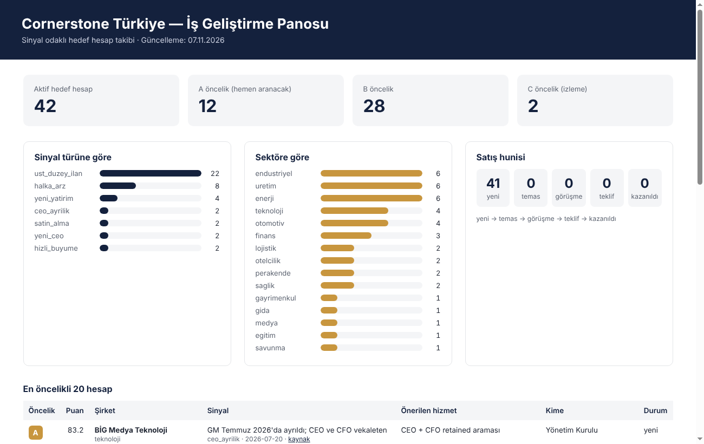

# newone — Cornerstone Türkiye İş Geliştirme Sistemi

**Sinyal odaklı müşteri bulma motoru:** Cornerstone Executive Search Türkiye'nin hizmetlerine (üst düzey yönetici araması, yönetim kurulu araması, pazar haritalama, halef planlaması, outplacement, interim yönetim) ihtiyaç duyacak şirketleri **ihtiyacın doğduğu anda** bulmak, önceliklendirmek ve düzenli bir ritimle ulaşmak için kurulmuş sistem.

> Temel fikir: Şirketler ancak bir **olay** yaşadığında üst düzey yönetici arar — CEO ayrılır, fabrika açılır, halka arz olunur, şirket satın alınır, direktör ilanı haftalarca açık kalır. Bu olayları ilk yakalayan, işi alır.



---

## İçindekiler

| Klasör / dosya | Ne işe yarar |
|---|---|
| [`docs/01-yol-haritasi.md`](docs/01-yol-haritasi.md) | 4 aşamalı yol haritası, ilk 90 gün planı, 12 aylık ölçekleme fikirleri, KPI'lar |
| [`docs/02-haftalik-calisma-plani.md`](docs/02-haftalik-calisma-plani.md) | Haftalık takvim (work schedule), KPI hunisi, 8 temaslık takip ritmi |
| [`docs/03-sinyal-rehberi.md`](docs/03-sinyal-rehberi.md) | 9 sinyal türü, nereden ve ne sıklıkla taranacağı, sinyal → hizmet eşlemesi |
| [`docs/04-linkedin-aramalari.md`](docs/04-linkedin-aramalari.md) | Tek tıkla açılan hazır LinkedIn aramaları (fonksiyon ve sektör bazlı) |
| [`docs/05-temas-sablonlari.md`](docs/05-temas-sablonlari.md) | Sinyale özel e-posta / LinkedIn / telefon şablonları ve itiraz karşılama |
| [`docs/06-mudur-sunumu.md`](docs/06-mudur-sunumu.md) | Yöneticiye 3 dakikalık demo akışı |
| [`data/hedef-hesaplar.csv`](data/hedef-hesaplar.csv) | Hedef hesap veritabanı (42 hesap, kaynak linkleriyle) |
| [`araclar/pipeline.py`](araclar/pipeline.py) | Puanlama, haftalık liste ve pano üreten araç |
| [`raporlar/`](raporlar/) | Üretilen haftalık arama listeleri |
| [`panel/index.html`](panel/index.html) | Yöneticiye gösterilecek HTML pano |
| [`bulten/`](bulten/) | "Pazar Nabzı" aylık bülten taslakları (İK direktörlerine değer odaklı içerik) |

---

## Hızlı başlangıç

Python 3.8+ yeterli; ek paket gerekmez.

```bash
# 1) Tüm hesapları puan sırasıyla gör
python araclar/pipeline.py liste

# 2) Bu haftanın arama listesini üret  -> raporlar/haftalik-liste-YYYY-Hxx.md
python araclar/pipeline.py hafta

# 3) Panoyu güncelle -> panel/index.html (tarayıcıda aç)
python araclar/pipeline.py panel

# 4) Yeni bir sinyal ekle
python araclar/pipeline.py ekle --sirket "Örnek Enerji A.Ş." --sektor enerji \
  --sinyal yeni_yatirim --ozet "Konya'da yeni GES yatırımı" --tarih 2026-11-10 \
  --kaynak https://... --kademe direktor --hizmet "İlk 5 yönetici paketi" --unvan "Genel Müdür"

# 5) Bir temastan sonra durumu güncelle
python araclar/pipeline.py guncelle --id 1 --durum temas \
  --sonraki "Telefon – 2. deneme" --sonraki-tarih 2026-11-12 --kisi "Ad Soyad"
```

`--bugun 2026-11-07` gibi bir tarih vererek hesaplamaları belirli bir güne sabitleyebilirsiniz.

---

## Puanlama nasıl çalışır?

`Puan = sinyal ağırlığı + sinyal tazeliği + sektör uyumu + pozisyon kademesi` (en fazla 95)

| Bileşen | Mantık |
|---|---|
| Sinyal ağırlığı | Vekaleten CEO/GM 30 · üst düzey ilan 25 · satın alma 22 · halka arz / yeni yatırım 20 · yeni CEO 15 · hızlı büyüme / küçülme 12 · izleme 5 |
| Sinyal tazeliği | En fazla 25 puan; sinyal türüne göre farklı hızda azalır (ilan 21 günde yarıya iner, yatırım 180 günde) |
| Sektör uyumu | Odak sektörler (otomotiv, endüstriyel, üretim, enerji, teknoloji, savunma, finans) 20, diğerleri 8 |
| Kademe | C-level 20 · direktör 15 · müdür 8 |

**A ≥ 75** (bu hafta ara) · **B ≥ 60** (2 hafta içinde) · **C** (izle). `durum=off-limits` olan şirketler (mevcut müşteriler) puanlanmaz.

---

## Haftalık döngü

```
Pazartesi  sinyal taraması → CSV'ye ekle → `hafta` → arama listesi
Salı–Prş   arama blokları (10:00–12:00, 14:30–16:30) → `guncelle`
Cuma       takip e-postaları → `panel` → haftalık değerlendirme
```

Ayrıntılar: [`docs/02-haftalik-calisma-plani.md`](docs/02-haftalik-calisma-plani.md)

---

## Notlar
- Veriler 7 Kasım 2026 itibarıyla açık kaynaklardan (KAP, LinkedIn, Rekabet Kurumu, halka arz takvimleri, iş basını) derlenmiştir; LinkedIn ilanları kapanmış olabilir, bazı sinyal tarihleri tahminidir (`notlar` sütununda belirtilmiştir).
- Kişi isimleri bilinçli olarak eklenmemiştir; karar vericiler temas öncesinde LinkedIn'den bulunur.
- Cornerstone'un mevcut müşterileri ve off-limits listesi sisteme işlenmeden temas yapılmamalıdır.
